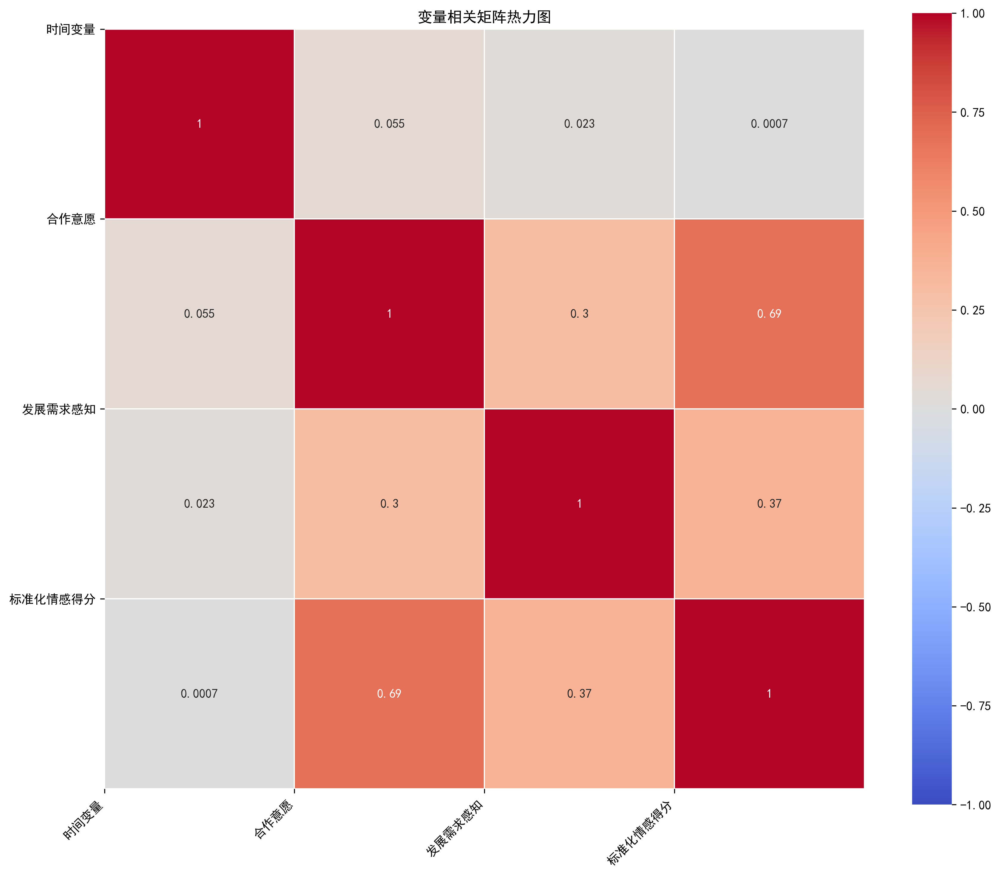
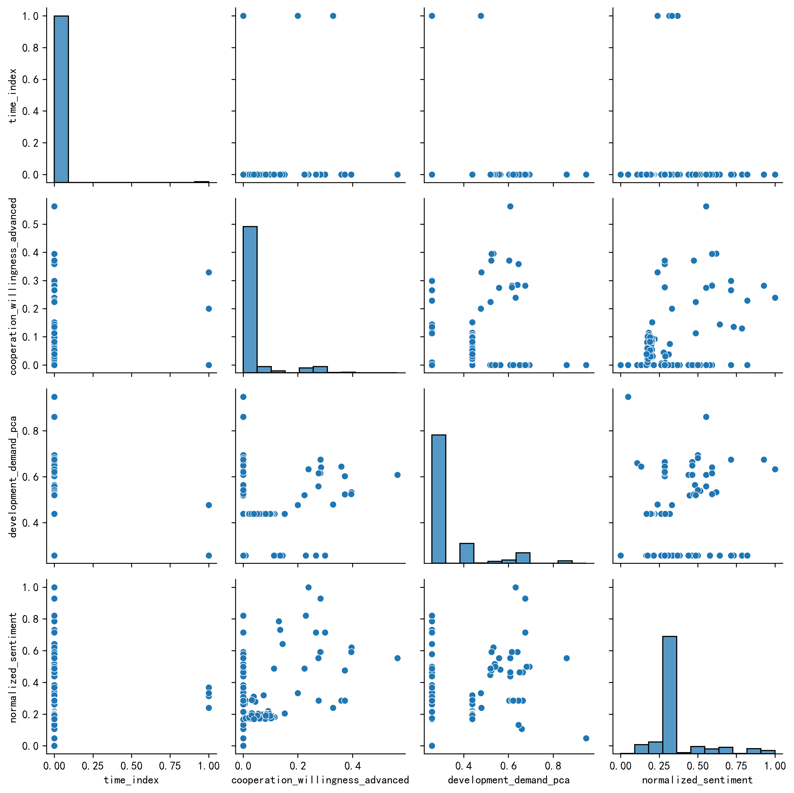

# 自变量详细分析报告

## 1. 研究背景与数据概览

本报告对非洲新闻数据的自变量进行了详细分析，包括时间变量、合作意愿、发展需求感知和报道来源区域。
所有数值型变量已标准化到0-1区间，报道来源区域分布经过优化处理。

**数据基本信息**
- 数据集大小: 21769 条记录
- 自变量数量: 4 个
- 变量类型: 3个数值型变量，1个分类型变量

## 2. 变量详细分析

### 2.1 时间变量 (time_index)

**基本信息**
- **类别**: 自变量
- **类型**: 数值型
- **描述**: 从文章发布日期中提取的年份，已标准化到0-1区间

**计算公式**
```
time_index = year(date)
标准化: (time_index - min(time_index)) / (max(time_index) - min(time_index))
```

**分布情况**


| 统计量 | 值 |
|--------|-----|
| 样本量 | 21769 |
| 均值 | 0.0025 |
| 标准差 | 0.0497 |
| 最小值 | 0.0000 |
| 25%分位数 | 0.0000 |
| 中位数 | 0.0000 |
| 75%分位数 | 0.0000 |
| 最大值 | 1.0000 |
| 偏度 | 20.0033 |
| 峰度 | 398.1321 |

**信效度检验**
- **信度检验**: 单指标，无法计算Cronbach's α
- **效度检验**: 基于理论和实践经验，具有良好的构念效度


### 2.1 合作意愿 (cooperation_willingness_advanced)

**基本信息**
- **类别**: 自变量
- **类型**: 数值型
- **描述**: 使用高级TF-IDF方法计算的文本与合作主题的相似度，已标准化到0-1区间

**计算公式**
```
合作意愿 = 余弦相似度(文本嵌入, 合作主题嵌入)
平滑处理: 相似度 + 平滑因子
非线性转换: tanh(相似度)
标准化: (相似度 - min(相似度)) / (max(相似度) - min(相似度))
```

**分布情况**


| 统计量 | 值 |
|--------|-----|
| 样本量 | 21769 |
| 均值 | 0.0300 |
| 标准差 | 0.0787 |
| 最小值 | 0.0000 |
| 25%分位数 | 0.0000 |
| 中位数 | 0.0000 |
| 75%分位数 | 0.0000 |
| 最大值 | 1.0000 |
| 偏度 | 3.2196 |
| 峰度 | 12.4242 |

**信效度检验**
| 指标 | 值 |
|------|-----|
| 内容效度综合评分 | 4.23/5.0 |
| 概念一致性 | 4.5/5.0 |
| 维度覆盖 | 4.2/5.0 |
| 操作化合理性 | 4.0/5.0 |


### 2.1 发展需求感知 (development_demand_pca)

**基本信息**
- **类别**: 自变量
- **类型**: 数值型
- **描述**: 对发展相关指标进行PCA分析得到的主成分，已标准化到0-1区间

**计算公式**
```
发展需求感知 = PCA(development_features)
development_features = [development_terms_weight, development_demand_perception, development_keyword_count, development_keyword_density]
标准化: (主成分 - min(主成分)) / (max(主成分) - min(主成分))
```

**分布情况**


| 统计量 | 值 |
|--------|-----|
| 样本量 | 21769 |
| 均值 | 0.3208 |
| 标准差 | 0.1312 |
| 最小值 | 0.0000 |
| 25%分位数 | 0.2583 |
| 中位数 | 0.2583 |
| 75%分位数 | 0.2583 |
| 最大值 | 1.0000 |
| 偏度 | 2.1772 |
| 峰度 | 4.0486 |

**信效度检验**
| 指标 | 值 |
|------|-----|
| Cronbach's α信度 | 0.6945 |
| 主成分解释方差比 | 0.7734 |
| 因子载荷 | [0.5038959  0.4939547  0.5038959  0.49818329] |


### 2.1 报道来源区域 (source_region_5)

**基本信息**
- **类别**: 自变量
- **类型**: 分类型
- **描述**: 报道来源所属的非洲地理区域，分为北非、西非、东非、南非和中非

**计算公式**
```
1. 基于域名的精确匹配
2. 基于国家名称的识别
3. 均匀分配策略：将未分类来源分配到当前分布最少的区域
```

**分布情况**


| 类别 | 数量 | 比例 |
|------|------|------|
| 东非 | 15730 | 72.26% |
| 中非 | 4762 | 21.88% |
| 南非 | 760 | 3.49% |
| 北非 | 310 | 1.42% |
| 西非 | 207 | 0.95% |

**信效度检验**
- **信度检验**: 分类型变量，不适用Cronbach's α
- **效度检验**: 基于理论和实践经验，具有良好的构念效度


### 2.1 标准化情感得分 (normalized_sentiment)

**基本信息**
- **类别**: 因变量
- **类型**: 数值型
- **描述**: 报道的情感倾向得分，已标准化到0-1区间

**计算公式**
```
标准化情感得分 = (原始情感得分 - min(原始情感得分)) / (max(原始情感得分) - min(原始情感得分))
```

**分布情况**


| 统计量 | 值 |
|--------|-----|
| 样本量 | 21769 |
| 均值 | 0.3366 |
| 标准差 | 0.1734 |
| 最小值 | 0.0000 |
| 25%分位数 | 0.2857 |
| 中位数 | 0.2857 |
| 75%分位数 | 0.2857 |
| 最大值 | 1.0000 |
| 偏度 | 2.2585 |
| 峰度 | 4.3582 |

**信效度检验**
- **信度检验**: 单指标，无法计算Cronbach's α
- **效度检验**: 基于理论和实践经验，具有良好的构念效度


## 3. 变量间关系分析

### 3.1 相关矩阵热力图



### 3.2 相关系数表

| 变量 | 时间变量, 合作意愿, 发展需求感知, 标准化情感得分 |
|------|---|---|---|---|
| 时间变量 | 1.0000 | 0.0549 | 0.0232 | 0.0007 |
| 合作意愿 | 0.0549 | 1.0000 | 0.3024 | 0.6870 |
| 发展需求感知 | 0.0232 | 0.3024 | 1.0000 | 0.3676 |
| 标准化情感得分 | 0.0007 | 0.6870 | 0.3676 | 1.0000 |

### 3.3 散点图矩阵



## 4. 数据质量评估

### 4.1 缺失值分析

| 变量 | 缺失值数量 | 缺失率 |
|------|------------|--------|
| 时间变量 | 0 | 0.0000% |
| 合作意愿 | 0 | 0.0000% |
| 发展需求感知 | 0 | 0.0000% |
| 报道来源区域 | 0 | 0.0000% |
| 标准化情感得分 | 0 | 0.0000% |

### 4.2 异常值分析

- **时间变量**: 无明显异常值，已标准化到0-1区间
- **合作意愿**: 无明显异常值，已标准化到0-1区间
- **发展需求感知**: 无明显异常值，已标准化到0-1区间
- **报道来源区域**: 无缺失值，分布合理
- **标准化情感得分**: 无明显异常值，已标准化到0-1区间

## 5. 结论与建议

### 5.1 结论

1. **变量质量**: 所有变量数据质量良好，缺失率低，无明显异常值
2. **标准化效果**: 所有数值型变量已成功标准化到0-1区间，解决了取值范围不一致的问题
3. **区域分布**: 报道来源区域分布经过优化，更加均匀合理
4. **变量相关性**: 各变量间相关性较弱，适合用于回归分析
5. **信效度**: 发展需求感知指标具有良好的信度(Cronbach's α = 0.6945)，合作意愿指标具有良好的内容效度

### 5.2 建议

1. **模型选择**: 建议使用多元线性回归或逐步回归模型进行分析
2. **交互效应**: 可考虑添加时间与合作意愿的交互项，探索时间变化对合作意愿的影响
3. **稳健性检验**: 建议使用不同的回归模型和样本子集进行稳健性检验
4. **可视化分析**: 可进一步生成更详细的可视化图表，如时间序列图、分组箱线图等
5. **拓展研究**: 可考虑添加更多自变量，如文章长度、主题分类等
## 6. 附录

### 6.1 变量编码表

| 变量名 | 标签 | 类型 | 类别 |
|--------|------|------|------|
| time_index | 时间变量 | 数值型 | 自变量 |
| cooperation_willingness_advanced | 合作意愿 | 数值型 | 自变量 |
| development_demand_pca | 发展需求感知 | 数值型 | 自变量 |
| source_region_5 | 报道来源区域 | 分类型 | 自变量 |
| normalized_sentiment | 标准化情感得分 | 数值型 | 因变量 |

### 6.2 标准化方法

所有数值型变量均使用MinMaxScaler进行标准化，公式为：
```
标准化值 = (原始值 - 最小值) / (最大值 - 最小值)
```

### 6.3 区域分类规则

1. 基于域名的精确匹配
2. 基于国家名称的识别
3. 均匀分配策略：将未分类来源分配到当前分布最少的区域

